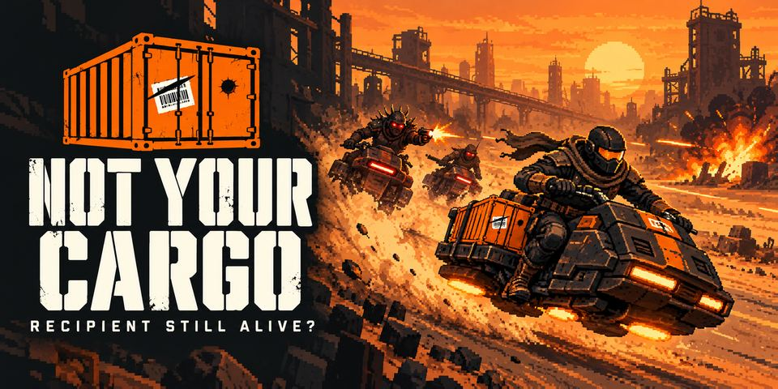

# NOT YOUR CARGO

**Deliver the cargo through the ambush. Then steal it from a friend.**

A browser top-down hover-bike shooter on [iDos Games](https://idosgames.com/app/QA0X2DY9/): a five-mission campaign and a real-time private 1v1 duel over a single crate. Built on the official iDos SDK and modules; Solana mainnet token **Not Your Cargo (NYCARGO)** unlocks cosmetics only — no token is needed to play and nothing in combat depends on it.

- ▶️ Play: https://idosgames.com/app/QA0X2DY9/ (direct: https://qa0x2dy9.idos.games/)
- Token: `5RWFPAucUS9h4bx1ApTftAWc87jVMxzPTkZwVHSeidos` (Solana mainnet, SPL, 6 decimals) · [Solscan](https://solscan.io/token/5RWFPAucUS9h4bx1ApTftAWc87jVMxzPTkZwVHSeidos)
- iDos title: `QA0X2DY9` · live build v18 (`bld8290005154cc4f1ca1742bc6eae306f0`)

> Русская версия описания — [docs/README.ru.md](docs/README.ru.md).



## What you play

**Campaign — «Courier's Route».** Story (4 slides) → training ground (8 steps) → five missions, each a 2–4 minute contract:

| | Mission | Goal |
|---|---|---|
| C01 | First Delivery | Three runs: deliver the parcel, bring the return parcel back to the depot, deliver again |
| C02 | Ambush | Pick the short turret road or the long sandstorm loop — twice |
| C03 | Convoy | Escort a truck through three ambushes; it breaks down halfway |
| C04 | Station | Download nav data, grab the core, hold out 50 s in a blackout, evacuate |
| C05 | Interceptor | Chase, boss fight (rocket fans + ram charges with telegraphed lines), final delivery |

Three difficulties (Easy / Normal / Hard) per mission, 1–3 stars, four weapons unlocked along the way (machine gun, scatter shot, laser, rockets), dispatcher radio with dark humour, 24 achievements, pixel-art sprites, and **server-checked rankings** (campaign and weekly duels).

**PvP — «Cargo Intercept» 1v1.** Private room by code → both pick a weapon and Ready → 3 s countdown → one crate in the middle of a symmetric arena; take it (hold E), carry it home (hold E), first to 3 deliveries wins. 4-minute clock, sudden death, draw, rematch with swapped sides. It is a **real network match between two people** (iDos rooms + WebRTC), never a bot.

**Controls.** PC: WASD move · mouse aim · LMB fire · Space dash · R reload · E take/deliver (hold) · Q drop · Esc menu. Phone: two sticks + dash/interact/drop/reload buttons, landscape.

## Solana: what the token does

| Feature | How it works | Trust |
|---|---|---|
| **Steppe Trail** cosmetic (bike trail + ring) | ≥ 1 NYCARGO in the wallet the player linked to their iDos account **by signature**; balance read on-chain for the exact mint every session | Wallet verified by iDos; balance from Solana RPC; an RPC error is shown as an error, never as "0" |
| **Cargo crates → bike paints** | In-game NYCARGO balance (deposited through the site wallet) pays 50 NYCARGO per crate; the **iDos server** rolls the drop (60/28/10/2 %, every 10th crate adds an Epic/Legendary) | Server-authoritative; a 0 balance is refused by the server |
| **Achievement NFT souvenirs** | Player mints a Metaplex Core asset from their own wallet (≈0.002 SOL, paid by the player) for achievements their account has | Souvenir, not a proof — see limits below |

None of this changes speed, HP, weapons, damage, hitboxes or PvP access. Details: [docs/TOKEN.md](docs/TOKEN.md).

## How it is built

TypeScript · React 19 shell from the iDos host scaffold · **Phaser 3.90** scene · iDos SDK (`@idosgames/core`, `module-sdk`, `wallet`) · `@solana/web3.js`. The game is one iDos module (`game/src/modules/not-your-cargo`) next to the catalog `multiplayer` module.

- **Simulation** is a deterministic fixed-step (30 Hz) pure-TS core shared by the campaign and PvP (`sim/`), tested headless.
- **PvP** is host-authoritative: the host simulates both bikes, the guest sends inputs only (seq, matchId, edge counters), snapshots at 15 Hz, client prediction + 100 ms interpolation, 250 ms input watchdog, 10 s host watchdog, rulesVersion check.
- **iDos services used:** auth (guest / Google / wallet), multiplayer rooms + RealtimeSession (WebRTC), Title Data, CloudCode (`nycTrailBalance`), Lootbox, Item catalog, Leaderboards, User Custom Data (cloud save), Blockchain (linked wallets, crypto currency), Title MCP for config and build uploads.

Architecture: [docs/architecture.md](docs/architecture.md).

## Run it

```bash
cd game
npm install
npm run dev        # http://localhost:5180 (vite)
npm test           # vitest: rules, missions, match, network protocol, saves, crates, NFT encoding
npm run typecheck
npx vite build --base=./
```

End-to-end checks drive a real Chrome (`playwright-core`): `node e2e/campaign.mjs`, `mission.mjs`, `missions.mjs`, `duel.mjs` (two isolated profiles, real iDos rooms), `mobile.mjs`, `nft.mjs`, `cloud.mjs`; hosted: `URL=… node e2e/smoke-hosted.mjs`, `armory-hosted.mjs`. Results: [docs/QA.md](docs/QA.md).

## Honest limits

- PvP is a **private, unranked** mode: the host could be modified to cheat. No rewards depend on PvP results. A dropped WebRTC link re-connects by itself while both players stay in the room (tested: 4.2 s, match continues); leaving the room, closing the tab or more than 10 s of silence ends the match (host left → "aborted", guest left → technical win). Host migration and resuming after a page reload are not implemented.
- **Rankings are checked by the server (CloudCode):** campaign wins must come in mission order, take at least a realistic time and real time must pass between reports; the server computes the stars. A duel win counts only when **both** players report the same result (a pair is capped at 5 credited wins a day). A modified client can still play and report honestly-timed runs, and two colluding accounts can trade wins within the cap. Achievements stay client-side, so NFT souvenirs are souvenirs.
- Cross-device / cross-network play, real phones and human playtests are **not yet verified** — see [docs/VALIDATION.md](docs/VALIDATION.md).

## Docs

[License: MIT (code)](LICENSE) · [Spec (RU)](docs/TZ-STEPPE-RAIDERS.md) · [Build history](docs/BUILD-HISTORY.md) · [QA](docs/QA.md) · [Validation plan](docs/VALIDATION.md) · [Token](docs/TOKEN.md) · [Roadmap](docs/roadmap.md) · [Submission texts](docs/submission.md) · [Dev log (RU)](docs/P0-STATUS.md) · [Asset licenses](assets/ATTRIBUTION.md)

## Team

**[Owner — name, role, contact: fill in before submitting]** — product decisions, token, testing. Code written with AI agents (Claude Code; Azure-hosted agents for sprites/audio) through the official iDos MCP servers — see [docs/BUILD-HISTORY.md](docs/BUILD-HISTORY.md).
